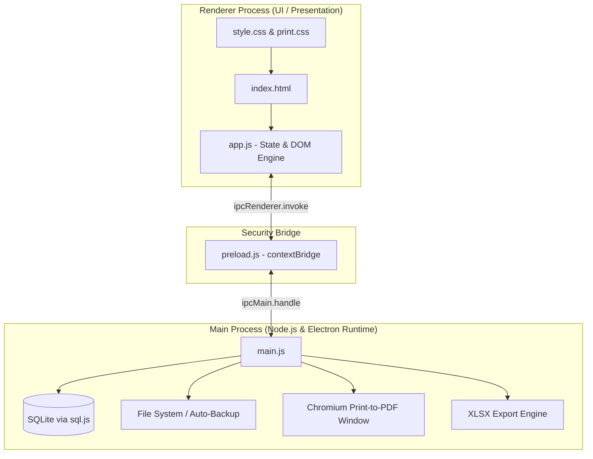
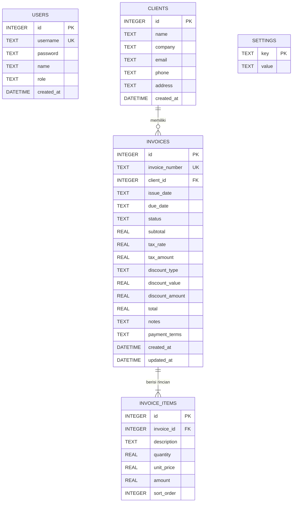

# TECHNICAL DOCUMENTATION & SYSTEM MANUAL
## INVOICE MASTER - DESKTOP EDITION v1.0.1
**Pengembang**: QuraisEnterprise  
**Lisensi**: Copyright &copy; 2026 QuraisEnterprise. All rights reserved.  
**Target Platform**: Microsoft Windows 10 / 11 (64-bit)

---

## 📑 DAFTAR ISI
1. [Ringkasan Arsitektur & Spesifikasi Teknis](#1-ringkasan-arsitektur--spesifikasi-teknis)
2. [Tech Stack yang Digunakan](#2-tech-stack-yang-digunakan)
3. [Alur Arsitektur & Keamanan IPC](#3-alur-arsitektur--keamanan-ipc)
4. [Skema Database Lengkap & ERD](#4-skema-database-lengkap--erd)
5. [Fitur-Fitur Khusus & Implementasi Teknis](#5-fitur-fitur-khusus--implementasi-teknis)
6. [Panduan Instalasi & Penggunaan](#6-panduan-instalasi--penggunaan)
7. [Panduan Build & Packaging Installer](#7-panduan-build--packaging-installer)

---

## 1. RINGKASAN ARSITEKTUR & SPESIFIKASI TEKNIS

**Invoice Master** adalah aplikasi desktop modern yang dirancang khusus untuk manajemen faktur, penagihan, database pelanggan, dan laporan keuangan offline secara mandiri. Aplikasi berjalan 100% tanpa ketergantungan internet (*air-gapped capable*), memanfaatkan database lokal berbasis SQLite WebAssembly.



### Prinsip Desain Utama:
1. **Zero-Configuration Deployment**: Tidak memerlukan instalasi server pihak ketiga (seperti MySQL, PostgreSQL, XAMPP, atau Apache).
2. **Strict Security Isolation**: Proses renderer tidak memiliki akses langsung ke modul sensitif Node.js (`fs`, `child_process`). Seluruh akses IO dijembatani oleh `contextBridge` yang aman.
3. **Data Integrity & Audit Trail**: Penomoran faktur dan rekaman nominal transaksi disimpan secara independen per transaksi.
4. **Professional Print Fidelity**: Hasil cetak langsung dan berkas PDF berstandar presisi kertas internasional A4 (210mm x 297mm).

---

## 2. TECH STACK YANG DIGUNAKAN

| Kategori | Teknologi | Versi | Peran & Alasan Pemilihan |
| :--- | :--- | :--- | :--- |
| **Core Framework** | **Electron.js** | `^33.2.1` | Kerangka kerja desktop lintas platform berbasis Chromium & Node.js untuk performa native Windows. |
| **Runtime Environment** | **Node.js** | `>=20.x` / `22.x` | Menjalankan proses utama, IPC, manajemen file IO, dan kompilasi installer. |
| **Database Engine** | **SQLite 3 (`sql.js`)** | `^1.12.0` | Mesin database relasional yang dikompilasi ke WebAssembly (WASM). Ringan, cepat, ACID-compliant, dan tersimpan dalam berkas tunggal (`invoices.sqlite`). |
| **Report Spreadsheet Engine** | **SheetJS (`xlsx`)** | `^0.18.5` | Pustaka manipulasi spreadsheet untuk mengekspor laporan komprehensif ke format Microsoft Excel Workbook (`.xlsx`). |
| **Presentation / UI** | **Vanilla HTML5 & CSS3 Modern** | Standar W3C | Antarmuka pengguna responsif dengan estetika gelap (*Dark Theme Slate*), aksen Indigo/Emerald, glassmorphism, dan tata letak print ramah A4. |
| **Client-Side Logic** | **Vanilla JavaScript (ES6+)** | Standar ES2022 | Manajemen state reaktif tanpa overhead framework eksternal, format mata uang lokal (`id-ID`), kalkulasi otomatis, dan manipulasi DOM instan. |
| **Packaging & Installer** | **electron-builder (NSIS)** | `^26.15.3` | Membangun installer Windows executable (`.exe`) berbasis NSIS x64 profesional dengan shortcut desktop, start menu, dan uninstaller. |

---

## 3. ALUR ARSITEKTUR & KEAMANAN IPC

Aplikasi mengimplementasikan standar keamanan resmi Electron:
- `contextIsolation: true`: Memisahkan konteks eksekusi JavaScript antara halaman web dan API internal Electron.
- `nodeIntegration: false`: Mencegah injeksi kode berbahaya dari DOM ke lingkungan sistem operasi.
- `sandbox: false`: Memungkinkan penggunaan preload script resmi untuk mengekspos API yang diotorisasi via `window.electronAPI`.

### Daftar Saluran IPC (Inter-Process Communication):

| Saluran (Channel) | Arah | Fungsi |
| :--- | :--- | :--- |
| `auth:login` | Renderer &rarr; Main | Memverifikasi kredensial username dan password admin. |
| `auth:checkRateLimit` | Renderer &rarr; Main | Mengecek status kunci login brute-force (3x gagal = 5 menit). |
| `dashboard:getStats` | Renderer &rarr; Main | Mengambil ringkasan omzet lunas, tagihan pending, overdue, & faktur terbaru. |
| `clients:getAll` / `clients:save` / `clients:delete` | Renderer &rarr; Main | Operasi CRUD data pelanggan. |
| `invoices:getAll` / `invoices:getById` | Renderer &rarr; Main | Mengambil daftar faktur (dengan filter) dan detail faktur beserta item rincian. |
| `invoices:getNextNumber` | Renderer &rarr; Main | Menghasilkan nomor faktur otomatis berdasarkan tanggal terbit (`INV-DDMMYYYY-XXXX`). |
| `invoices:save` / `invoices:updateStatus` / `invoices:delete` | Renderer &rarr; Main | Menyimpan, mengubah status pembayaran, atau menghapus faktur. |
| `settings:get` / `settings:save` | Renderer &rarr; Main | Membaca dan memperbarui konfigurasi profil bisnis perusahaan. |
| `export:excel` | Renderer &rarr; Main | Menyusun sheet dan menyimpan file laporan `.xlsx`. |
| `export:pdf` | Renderer &rarr; Main | Membuka jendela cetak headless dan merender PDF vektor A4 via `printToPDF`. |
| `backup:manual` / `backup:getStatus` / `backup:openFolder` | Renderer &rarr; Main | Menjalankan pencadangan SQLite manual dan membuka folder Downloads. |
| `backup:auto-completed` | Main &rarr; Renderer | Mengirim event notifikasi saat pencadangan mingguan otomatis selesai. |

---

## 4. SKEMA DATABASE LENGKAP & ERD

### Entity Relationship Diagram (ERD)



---

### Rincian Tabel Database

#### 1. Tabel `users`
Menyimpan data otentikasi pengguna aplikasi.
```sql
CREATE TABLE IF NOT EXISTS users (
  id INTEGER PRIMARY KEY AUTOINCREMENT,
  username TEXT UNIQUE NOT NULL,
  password TEXT NOT NULL,
  name TEXT NOT NULL,
  role TEXT DEFAULT 'admin',
  created_at DATETIME DEFAULT CURRENT_TIMESTAMP
);
```

#### 2. Tabel `clients`
Menyimpan direktori kontak pelanggan dan mitra bisnis.
```sql
CREATE TABLE IF NOT EXISTS clients (
  id INTEGER PRIMARY KEY AUTOINCREMENT,
  name TEXT NOT NULL,
  company TEXT,
  email TEXT,
  phone TEXT,
  address TEXT,
  created_at DATETIME DEFAULT CURRENT_TIMESTAMP
);
```

#### 3. Tabel `invoices`
Tabel master transaksi penagihan / faktur penjualan.
```sql
CREATE TABLE IF NOT EXISTS invoices (
  id INTEGER PRIMARY KEY AUTOINCREMENT,
  invoice_number TEXT UNIQUE NOT NULL,
  client_id INTEGER REFERENCES clients(id) ON DELETE SET NULL,
  issue_date TEXT NOT NULL,
  due_date TEXT NOT NULL,
  status TEXT DEFAULT 'unpaid',
  subtotal REAL NOT NULL DEFAULT 0,
  tax_rate REAL NOT NULL DEFAULT 0,
  tax_amount REAL NOT NULL DEFAULT 0,
  discount_type TEXT DEFAULT 'percentage',
  discount_value REAL NOT NULL DEFAULT 0,
  discount_amount REAL NOT NULL DEFAULT 0,
  total REAL NOT NULL DEFAULT 0,
  notes TEXT,
  payment_terms TEXT,
  created_at DATETIME DEFAULT CURRENT_TIMESTAMP,
  updated_at DATETIME DEFAULT CURRENT_TIMESTAMP
);
```

#### 4. Tabel `invoice_items`
Rincian setiap barang/jasa dalam satu faktur (One-to-Many dari `invoices`).
```sql
CREATE TABLE IF NOT EXISTS invoice_items (
  id INTEGER PRIMARY KEY AUTOINCREMENT,
  invoice_id INTEGER NOT NULL REFERENCES invoices(id) ON DELETE CASCADE,
  description TEXT NOT NULL,
  quantity REAL NOT NULL DEFAULT 1,
  unit_price REAL NOT NULL DEFAULT 0,
  amount REAL NOT NULL DEFAULT 0,
  sort_order INTEGER DEFAULT 0
);
```

#### 5. Tabel `settings`
Konfigurasi profil bisnis (Key-Value Store).
```sql
CREATE TABLE IF NOT EXISTS settings (
  key TEXT PRIMARY KEY,
  value TEXT
);
```
*Daftar Kunci (Keys) Utama*:
- `company_name`: Nama resmi bisnis / perusahaan
- `company_tagline`: Slogan usaha
- `company_logo`: Berkas logo gambar dalam format Base64 DataURI
- `company_address`: Alamat lengkap kantor/workshop
- `company_phone`: Nomor telepon / WhatsApp kantor
- `company_email`: Email penagihan / billing
- `bank_name`: Nama bank transfer pembayaran
- `bank_account_number`: Nomor rekening bank
- `bank_account_holder`: Nama pemilik rekening (atas nama)
- `currency_symbol`: Simbol mata uang default (`Rp`)
- `default_tax_rate`: Tarif PPN default dalam persen (misal `11`)
- `default_payment_terms`: Syarat pembayaran standar
- `invoice_prefix`: Awalan nomor faktur (`INV`)

#### 6. Indeks Performa (Indexes)
```sql
CREATE INDEX IF NOT EXISTS idx_invoices_number ON invoices(invoice_number);
CREATE INDEX IF NOT EXISTS idx_invoices_client ON invoices(client_id);
CREATE INDEX IF NOT EXISTS idx_invoices_status ON invoices(status);
CREATE INDEX IF NOT EXISTS idx_invoices_issue_date ON invoices(issue_date);
CREATE INDEX IF NOT EXISTS idx_invoices_due_date ON invoices(due_date);
CREATE INDEX IF NOT EXISTS idx_invoice_items_invoice ON invoice_items(invoice_id);
CREATE INDEX IF NOT EXISTS idx_clients_name ON clients(name);
CREATE INDEX IF NOT EXISTS idx_clients_company ON clients(company);
```

---

## 5. FITUR-FITUR KHUSUS & IMPLEMENTASI TEKNIS

### A. Pencegahan Line-Break Prefix Mata Uang (`Rp`) & Dukungan Nominal > 1 Milyar
- **Non-Breaking Space Engine**: Fungsi pemformat uang menggunakan karakter unicode `\u00A0` antara simbol mata uang dan nominal angka (`Rp\u00A01.000.000.000,00`), sehingga Chromium engine tidak akan pernah memutus baris (line-break) prefix ke atas angka.
- **Rasio Kolom Kertas A4 Tetap**: Lebar kolom *Harga Satuan* dan *Total* ditetapkan masing-masing sebesar **24%** dengan properti `table-layout: fixed !important;` dan `white-space: nowrap !important;`.
- **Kotak Total Tagihan Fleksibel**: Kotak ringkasan totaltagihan berukuran 53% menjamin nominal hingga triliunan rupiah tidak tumpang-tindih.

### B. Auto-Scaling Kartu Statistik Dashboard
- Kartu statistik menggunakan penataan `.stat-card-header` (label di kiri, ikon di sudut kanan atas) yang memberikan **100% lebar kartu penuh** untuk baris angka (`.stat-value`).
- Logika penskalaan otomatis di JavaScript:
  - Angka dengan panjang karakter `> 14` digit diskalakan ke `1.14rem`.
  - Angka dengan panjang karakter `> 17` digit diskalakan ke `1.05rem`.
  - Dilengkapi atribut tooltip `title` untuk membaca angka lengkap saat di-hover.

### C. Sistem Pagination Daftar Invoice (10 Data per Halaman)
- State `state.invoicePagination` membagi dataset hasil query secara otomatis:
  ```javascript
  const startIndex = (curPage - 1) * pageSize;
  const endIndex = Math.min(startIndex + pageSize, totalItems);
  const pageInvoices = invoices.slice(startIndex, endIndex);
  ```
- Tombol navigasi dinamis: *Sebelumnya*, *1, 2, 3...*, *Selanjutnya*.
- Filter pencarian, tab status, dan filter tanggal otomatis mereset tampilan ke halaman 1.

### D. Sinkronisasi Pengaturan Bisnis Real-Time
- Setiap kali data di halaman **Pengaturan Bisnis** diperbarui:
  - Data langsung di-*commit* ke SQLite database dan memori runtime.
  - Tampilan faktur kertas (modal pratinjau) dan ekspor PDF memprioritaskan konfigurasi aktif (`s.default_payment_terms || inv.payment_terms`).
  - Seluruh invoice lama (*existing*) otomatis mengadopsi logo, nama perusahaan, alamat, kontak, dan rekening bank terbaru tanpa perlu mengedit faktur satu per satu.

### E. Sistem Proteksi Brute-Force Login
- Percobaan salah dipantau di memori utama:
  - Maksimal percobaan: **3 kali**.
  - Jika gagal 3x, akses dikunci selama **5 menit (300 detik)**.
  - Dilengkapi timer hitung mundur (`MM:SS`) real-time yang tersinkronisasi di antarmuka login.

### F. Sistem Pencadangan Otomatis Mingguan (Auto-Backup)
- Saat aplikasi dibuka, background service mengecek tanggal pencadangan terakhir.
- Jika sudah melewati 7 hari, seluruh database SQLite disalin otomatis ke:
  `C:\Users\<User>\Downloads\Backup_InvoiceMaster_DD-MM-YYYY_HH-mm.sqlite`
- Bebas risiko kehilangan data akibat kerusakan hardware komputer.

---

## 6. PANDUAN INSTALASI & PENGGUNAAN

### Persyaratan Sistem
- **Sistem Operasi**: Windows 10 atau Windows 11 (64-bit Architecture).
- **Prosesor**: Intel Core / AMD Ryzen (Dual-Core atau lebih tinggi).
- **RAM**: Minimal 2 GB (Disarankan 4 GB).
- **Penyimpanan Bebas**: Minimal 250 MB ruang kosong pada harddisk/SSD.

---

### Opsi 1: Instalasi Menggunakan Installer Resmi (Rekomendasi Pengguna Akhir)

1. Unduh atau salin berkas installer:
   [**`dist/Invoice_Master_Setup_v1.0.1.exe`**](file:///d:/Project%20Mandiri/Desktop%20App/invoice-generator-v2/dist/Invoice_Master_Setup_v1.0.1.exe)
2. Klik dua kali (*double click*) pada berkas **`Invoice_Master_Setup_v1.0.1.exe`**.
3. Wizard instalasi Windows (NSIS) akan terbuka:
   - Pilih direktori instalasi yang diinginkan (default: `C:\Program Files\Invoice Master` atau direktori akun pengguna).
   - Centang opsi pembuatan shortcut Desktop & Start Menu.
   - Klik **Install** dan tunggu beberapa detik hingga proses selesai.
4. Klik **Finish** untuk langsung menjalankan aplikasi.
5. Gunakan kredensial default untuk masuk:
   - **Username**: `superadmin`
   - **Password**: `Blessings777!`

---

### Opsi 2: Menjalankan dari Kode Sumber (Development Mode)

Bagi pengembang yang ingin memodifikasi atau mengembangkan fitur aplikasi:

1. **Prasyarat**:
   - Pastikan **Node.js** (versi 20.x atau 22.x LTS) dan **npm** sudah terpasang di komputer Anda.
   - Buka PowerShell atau Command Prompt.

2. **Instalasi Dependencies**:
   Arahkan terminal ke root project dan jalankan:
   ```bash
   cd "d:\Project Mandiri\Desktop App\invoice-generator-v2"
   npm install
   ```

3. **Menjalankan Aplikasi (Mode Live)**:
   ```bash
   npm start
   ```
   Atau cukup klik dua kali pada berkas script batch:
   [**`Jalankan_Aplikasi.bat`**](file:///d:/Project%20Mandiri/Desktop%20App/invoice-generator-v2/Jalankan_Aplikasi.bat).

---

## 7. PANDUAN BUILD & PACKAGING INSTALLER

Untuk mengompilasi ulang seluruh kode sumber menjadi berkas installer `.exe` baru setelah melakukan modifikasi:

1. Pastikan seluruh berkas telah tersimpan dan sintaks JavaScript valid:
   ```bash
   node -c main.js
   node -c src/renderer/js/app.js
   ```

2. Jalankan perintah build:
   ```bash
   npm run build
   ```

3. `electron-builder` akan otomatis memproses:
   - Rebuild dependensi native arsitektur `x64`.
   - Pengemasan aset aplikasi ke dalam berkas arsip `app.asar`.
   - Mengintegrasikan file binary WASM `sql-wasm.wasm`.
   - Memasukkan database default ke `resources/data/invoices.sqlite`.
   - Mengompilasi NSIS installer dengan metadata hak cipta resmi **QuraisEnterprise**.

4. Hasil file executable installer akan tersedia di:
   [**`dist/Invoice_Master_Setup_v1.0.1.exe`**](file:///d:/Project%20Mandiri/Desktop%20App/invoice-generator-v2/dist/Invoice_Master_Setup_v1.0.1.exe)

---

## 📞 DOKUMENTASI & KONTRIBUTOR
* **Pengembang**: QuraisEnterprise
* **Kontak Dukungan**: `billing@mandiripratama.co.id` / `adnan.qurais@gmail.com`
* **Status Rilis**: v1.0.1 Production Stable
